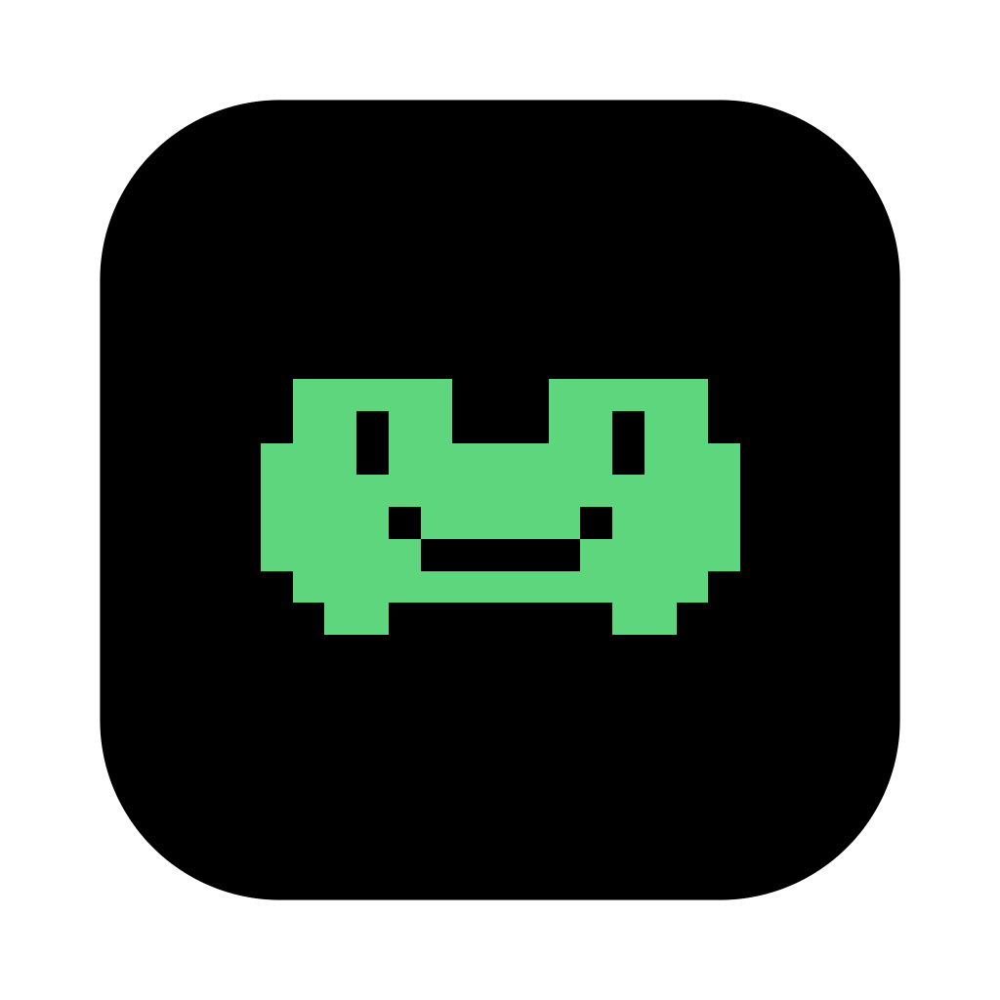
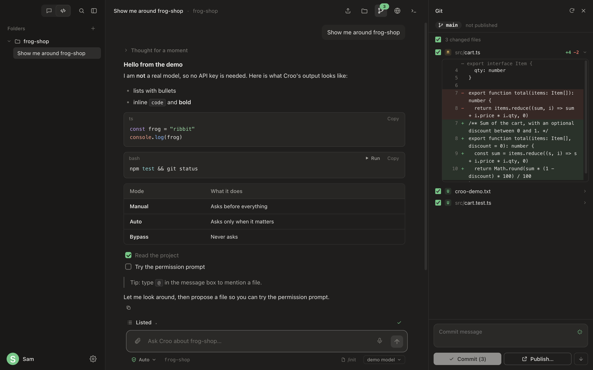
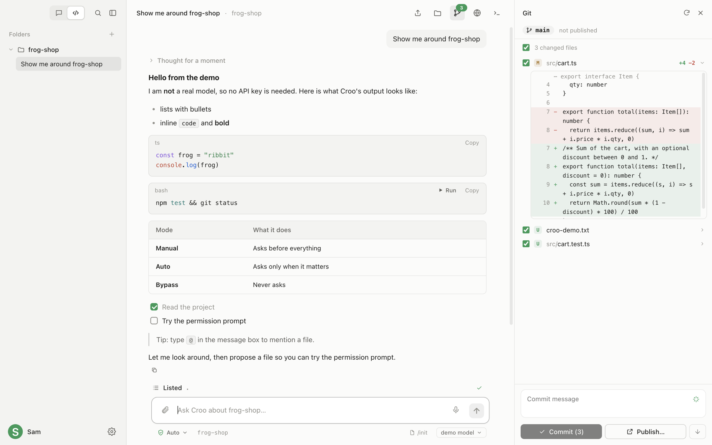
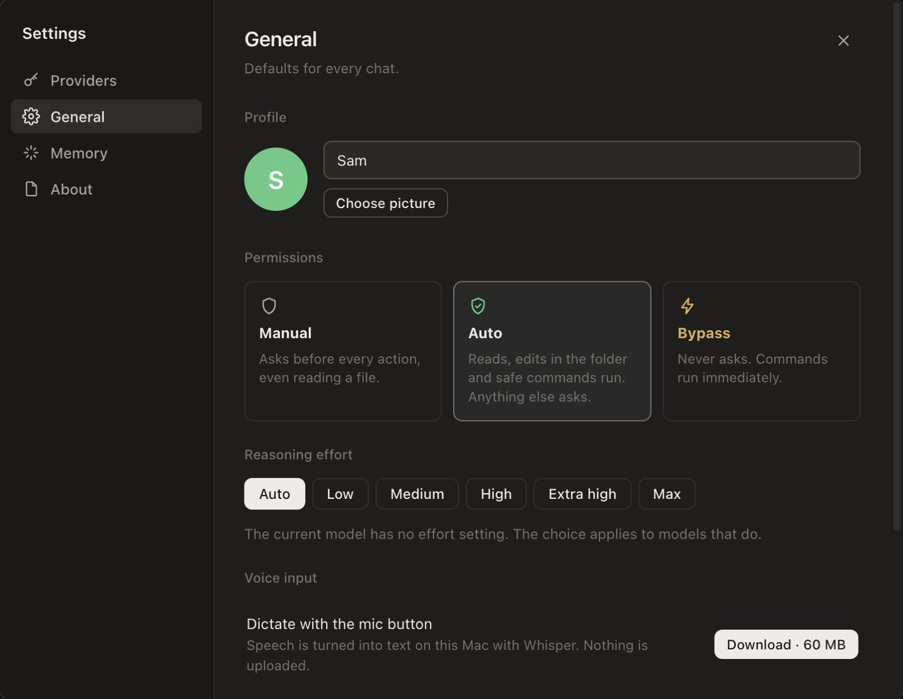

<div align="center">



# Croo

**A minimal desktop coding agent with a frog in it.**<br>
Bring your own API key, or a local model. No accounts, no telemetry, no backend.


[Website](https://ai.crooli.com/) · [Features](#features) · [Run it](#run-it) · [Providers](#providers-and-keys) · [Shortcuts](#shortcuts)

<br>



</div>

<br>

**Code** mode gives each project folder its own chats and lets the agent read, search, edit and run things in it. **Chat** mode is a plain conversation with no folder and no tools. You decide how much the agent may do on its own, and everything it does is visible: diffs, commands, output, reasoning, time and tokens.

## Features

| | |
| --- | --- |
| **Chat and Code** | Two icons at the top of the sidebar. Code lists your folders with a chat history each; Chat is a flat list of conversations. |
| **Permission modes** | **Manual** asks before everything. **Auto** runs reads, edits in the folder and known-safe commands, and asks about the rest. **Bypass** never asks. `⇧Tab` cycles. |
| **Git, built in** | Branch and sync state, changed files with `+/−` counts, inline diffs, pick what to commit, **Commit**, **Push**, **Pull**. No remote yet? **Publish** connects one by URL or `owner/repo`, or creates it on GitHub with `gh`. Failures come with a plain-language fix. |
| **Run code from the chat** | Shell, Python and Node snippets in a reply get a **Run** button. Output streams under the block with exit code and timing, and **Stop** while it runs. |
| **Files and Browser** | A `.gitignore`-aware file tree with a syntax-highlighted viewer that wraps long lines, and an in-app browser whose start page finds the dev servers running on your machine. |
| **Terminal** | A real shell in the folder (`⌘J`), with tabs (`⌘T`). |
| **Thinking, time and tokens** | Reasoning streams into an expandable "Thought for 4s" row. A live clock and token count run while the agent works. |
| **Models and effort** | The model chip lists what your key can actually use. The **Effort** control appears for models that have one and is clamped to what each model accepts. |
| **Attach and mention** | Paste or drop images and files into the message box, or use the paperclip. Type `@` to pick a file from the folder and it is sent along with your message. Big images are scaled down first. |
| **Search** | `⌘K` finds chats (by title or what was said), files and actions. |
| **Edit and retry** | Edit any message and resend (everything after it is replaced), or **Retry** the last reply. |
| **Cost** | Time, tokens and an estimated cost under each reply. Claude prices are built in, set your own for other providers, local models are free. |
| **Notifications and updates** | A system notification when a task finishes or needs your OK while Croo is in the background. A notice at the bottom left of the sidebar when a new version is out. |
| **Project instructions** | Reads `AGENTS.md`, `CLAUDE.md` and `CROO.md` every turn. `/init` studies the project and writes `AGENTS.md`. |
| **A frog** | Pixel art that breathes, blinks, hops, catches flies, falls asleep, and reacts to thinking, working, waiting, done and errors. Click it. |

<div align="center">


</div>

## Run it

```bash
git clone https://github.com/xandertaylorx/croo && cd croo
npm install
npm run dev
```

**Install on a Mac** (Apple Silicon) with one command, no Gatekeeper warning:

```bash
curl -fsSL https://ai.crooli.com/install.sh | bash
```

If you download the `.dmg` instead, macOS will say Croo is "damaged" because it isn't notarized; run `xattr -cr /Applications/Croo.app` once.

**No key?** Download the built-in local model (Qwen3 4B, ~2.5 GB) from Settings → Providers or the first-run screen; Croo runs it on your Mac itself.

First launch walks you through picking a provider and pasting a key, or choose **Just look around** for a scripted demo with no key. Build a distributable with `npm run dist` (a macOS `.dmg` and `.zip` in `release/`).

## Using it

- **Add a folder** with the `+` in the sidebar, `⌘O`, or by dropping one on the window. `⌘N` starts a chat.
- **Approve changes** with the buttons on the card, `⌘↵` to allow, `esc` to deny.
- **Hover** any button for its name and shortcut.
- **Small window?** The sidebar steps aside while a side panel is open, and nothing needs horizontal scrolling.
- **Poke the frog.** Leave it alone long enough and it falls asleep.

### Git

Tick the files you want, write a message, **Commit** (`⌘↵`), then **Push**. A new branch is published for you. **Pull** is fast-forward only, so it never makes a surprise merge. If a folder is not a repository, one click runs `git init`.

### Reasoning

When the model streams its reasoning (Claude, Gemini, and DeepSeek, Groq, OpenRouter or Ollama style reasoning), it shows as a quiet row you can expand, and is saved with the chat. Claude 4.6 and later think adaptively, older models use a token budget, and effort levels are sent only where a model accepts them. If an API refuses a setting, Croo drops it, remembers that, and carries on.

## Providers and keys

OpenAI, Anthropic, Google Gemini, or anything OpenAI-compatible: OpenRouter, Groq, Together, DeepSeek, Mistral, xAI, Ollama, LM Studio, llama.cpp, vLLM. **Settings** (`⌘,`) shows each provider as a card with its masked key, **Update** (verified before it is saved), and a model list.

Keys are encrypted with the OS keychain before they are written to `~/.config/croo`. Chats live in `~/.local/share/croo`. The only network calls are to the provider you choose. Croo works with API keys and OpenAI-compatible endpoints. It does not use anyone's consumer-subscription logins.

## Shortcuts

| Shortcut | Action | Shortcut | Action |
| --- | --- | --- | --- |
| `⌘1` / `⌘2` | Chat / Code | `⌘J` | Terminal (`⌘T` new tab) |
| `⌘N` | New chat | `⌘⇧E` | Files |
| `⌘O` | Add folder | `⌘⇧G` | Git |
| `⌘B` | Sidebar | `⌘⇧B` | Browser |
| `⌘K` | Search | `@` | Mention a file |
| `⇧Tab` | Permission mode | `⌘↵` / `esc` | Allow / deny |
| `⌘,` | Settings | `/init` | Write `AGENTS.md` |

## Releases and updates

Push a version tag and GitHub Actions builds the macOS app and attaches it to a GitHub Release:

```bash
git tag v0.7.0 && git push origin v0.7.0
```

The app checks the latest release on launch and every few hours and shows "Croo x.y.z is out" at the bottom left; clicking it downloads the installer for your Mac. Builds are unsigned until a Developer ID certificate is added to the repository secrets (see `.github/workflows/release.yml`), so macOS may ask you to confirm the first launch.

## Layout

```
src/main/       Electron main process, sandboxed preload bridge, terminal (node-pty), git, code runner
src/renderer/   The UI: plain TypeScript and CSS, no framework (frog.ts is the mascot)
src/agent.ts    Model and tool loop        src/providers/   OpenAI, Anthropic, Gemini
src/tools/      File, search, shell        src/effort.ts    Per-model reasoning settings
```

MIT licensed.
